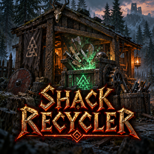

# Shack Recycler

**[Download on Thunderstore](https://thunderstore.io/c/valheim/p/TheShackDev/Shack_Recycler/)** · version 1.1.1 · part of [The Shack Pack](https://thunderstore.io/c/valheim/p/TheShackDev/The_Shack_Pack/)

Two new tabs at your crafting stations:

- **Recycle** (workbench, forge and stonecutter): turn things you crafted back into their materials: gear, tools, arrows, bolts, bombs, nails, bronze and more.
- **Research** (workbench): use up things you **can't craft yet** to learn their recipes. Food and meads count too.

## Recycle

- Open a workbench, forge or stonecutter and click the **Recycle** tab next to Craft and Upgrade.
- The list shows what in your inventory **that station** crafts, plus things that need no station (hammer, torch, club...).
- Items another Recycle station makes are listed greyed out with its name, e.g. "Ironhead arrow (Forge)".
- Pick an item to see exactly what you'll get back, then click **Recycle**.
- **Gear** (tools, weapons, armour) asks **Yes / No** first, and the popup shows what you'll get back.
- **Upgraded gear** gives back its upgrade materials too (this can be switched off).
- A **Shack Workbench Pack** backpack also gives back its packed-in stonecutter, if it has one.
- **Stacks** are recycled by the craft:
  - A click recycles what one craft makes (20 arrows). **Shift + click** recycles the whole stack.
  - Less than a full craft gives back its share, rounded down.
- What doesn't fit in your inventory drops at your feet.
- **Can't be recycled:**
  - equipped items
  - things you don't know how to craft yet (they show greyed out as "not known"; research them first)
  - food, meads and potions
- The station also needs the level that crafting (or upgrading to) the item needs.

**Recycling can never give back more than an item cost to make.** When an item has two recipes (Bronze and Bronze x5), it returns the cheaper of the two. Crafting and then recycling can't multiply materials.

**Only things you know how to craft can be recycled** (a setting, on by default). Recycling something from a tier you haven't reached would hand you its materials early, and those materials unlock more recipes. With this on, you research it first.

## Research

- At the **workbench**, open the **Research** tab. It lists everything in your inventory you **can't craft yet**, with your progress, e.g. "Black metal sword (2/5)". Items from any station can be researched there.
- Each research **uses the item up, and nothing comes back.** Stacks use one craft's worth per research (20 arrows).
- After **5 researches** you learn the recipe. You get the game's "New recipe" popup, and it appears at the station that crafts it. You still need the materials to craft it.
- **Food and meads:**
  - Food with its own recipe (cauldron food) is researched directly.
  - Researching a **mead** teaches its **mead base** (it ferments into that mead).
  - Researching **oven food** like bread teaches its **dough**.
  - Cooked meat and fish can't be researched; nobody crafts them.
- Progress is saved on your character, just like the recipes you know.
- Gear asks **Yes / No** first, like recycling.

## Settings

Set by the server admin in F1 (**Shack Recycler**). The server's values apply to everyone.

**1 - General**
- **Stations**: which stations get the Recycle tab. You can add `$piece_artisanstation`, `$piece_blackforge` or `$piece_magetable`.
- **Only known recipes** (on): only recycle what you know how to craft.
- **Station-free items** (on): the hammer, torch and other station-free items can be recycled at any Recycle station.
- **Require station level** (on).
- **Excluded item types** (`Consumable`), **Blocked items** and **Blocked materials**.

**2 - Returns**
- **Mode**: **Flat** (default) or **Luck**.
  - Flat gives back a fixed share of what the item cost: **100% by default**.
  - Luck rolls each material as crumbled / poor / normal / good / jackpot, and the **Recycling** skill improves the odds as you use it (sections 3 and 4).
- **Include upgrades** (on): upgraded items also give back what their upgrades cost.
- **Durability affects return** (off): worn items give back less.

**5 - Research**
- **Enabled** (on).
- **Stations** (`$piece_workbench`).
- **Researches needed** (5).
- **Excluded item types** (empty: anything with a recipe, food included).

**0 - This PC** (each player's own choice): **Ask before recycling**: **Gear** (default), **Everything** or **Never**. It applies to research too.

## Notes

- **Install it on the server and every client.** The server sends its settings to everyone (admin-only settings, through Jotunn).
- **The server and players need the same version** (1.1.x with 1.1.x). Players without the mod can still join; they just get no tabs.
- Works alongside My Little UI, Craft From Containers, Quick Stack - Store - Sort - Trash - Restock, Equipment and Quick Slots, and Zen.ModLib.
- Tested with Valheim 1.0.17, BepInExPack 5.4.2351 and Jotunn 2.30.2.

## Credits

The idea of a Recycle tab with luck rolls comes from **[Forge Reclaimer](https://thunderstore.io/c/valheim/p/Helgi/ForgeReclaimer/)** by Helgi. Shack Recycler is a separate mod written from scratch; it shares no code.

## Building from source

You need the [.NET SDK](https://dotnet.microsoft.com/download) (6.0 or newer) and Valheim. The project compiles against your own copies of the game's DLLs and BepInEx and Jotunn; none of them are in this repo.

```bash
dotnet build -c Release \
  -p:ValheimManaged="/path/to/Valheim/valheim_Data/Managed" \
  -p:ProfileRoot="/path/to/your/profile/BepInEx"
```

`ProfileRoot` is the `BepInEx` folder of any r2modman profile that has Jotunn (it needs `core/` and `plugins/ValheimModding-Jotunn/`). Without the `-p:` options the project looks for a Linux Steam install and an r2modman profile named "The Shack Pack Test Environment". The DLL lands in `bin/Release/`.

This is the source of version 1.1.1 on Thunderstore.

## License

MIT, see [LICENSE](LICENSE).

*This mod was written with the help of an AI assistant (Claude).*
